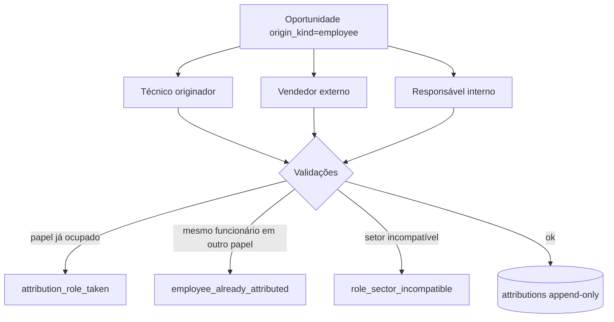
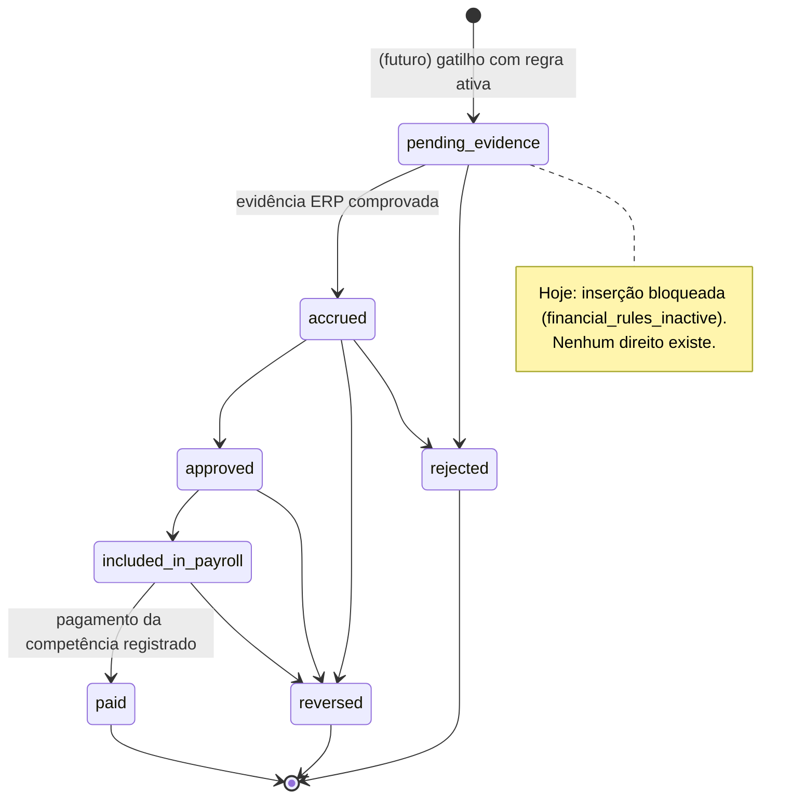
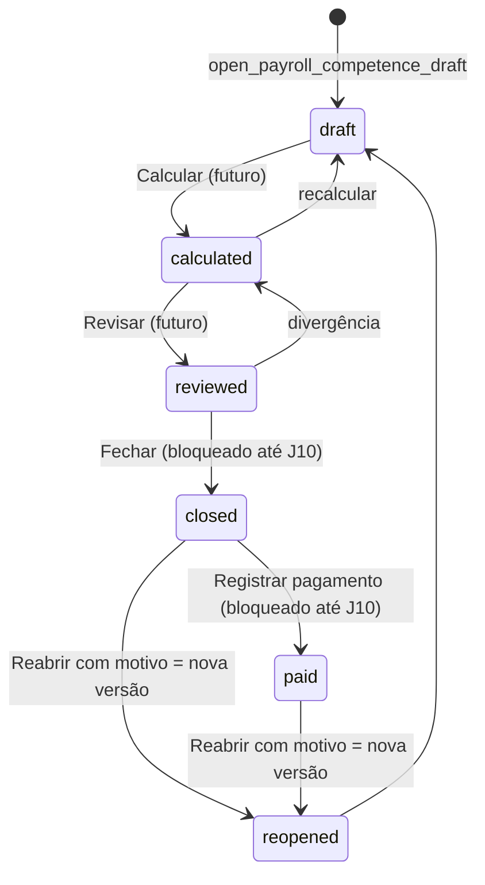
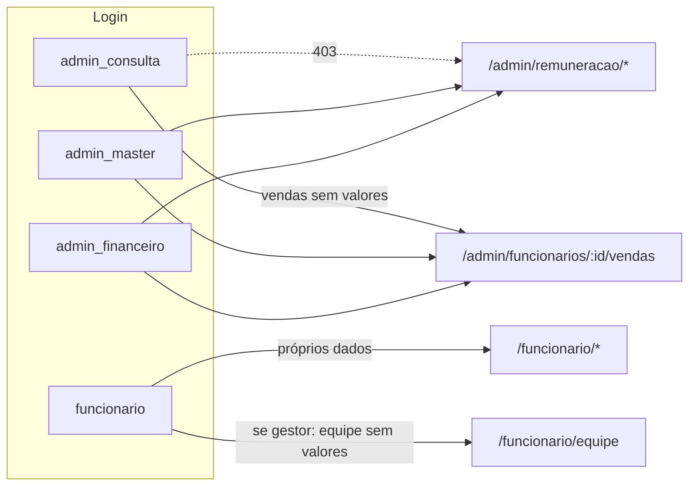

# 14 — Fluxos (Mermaid)

## 1. Criação de oportunidade pelo funcionário

```mermaid
sequenceDiagram
  actor F as Funcionário
  participant UI as /funcionario/nova-oportunidade
  participant API as POST /api/employee/sales-opportunities
  participant RPC as create_employee_sales_opportunity (JWT do usuário)
  participant DB as referrals + attributions
  F->>UI: preenche + ciência
  UI->>UI: gera Idempotency-Key; desabilita botão
  UI->>API: payload + Idempotency-Key
  API->>API: revalida role=funcionario
  API->>RPC: chamada com o JWT (nunca service_role)
  RPC->>RPC: employee ativo? membership ativa? chave repetida?
  alt chave já usada pelo mesmo funcionário
    RPC-->>API: ok, idempotent=true
  else nova
    RPC->>DB: referral origin_kind=employee, reward_eligible=false, status=pendente, pipeline_stage=novo
    RPC->>DB: attribution (papel do criador)
    RPC-->>API: ok, opportunity_id
  end
  API-->>UI: mensagem "na fila de Interessados"
  Note over DB: Nenhuma reward, carteira, Pix, ERP ou comissão
```

## 2. Atribuição (até 3 papéis, 1 papel por funcionário)



## 3. Ciclo da comissão (grafo do direito liberado)



## 4. Ciclo da competência (desenho; schema tem também `reopened`)



## 5. Permissões


